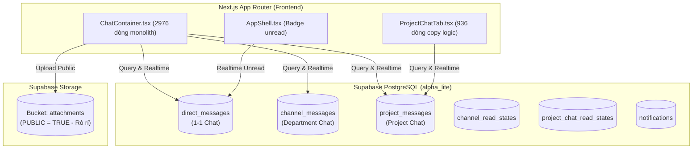
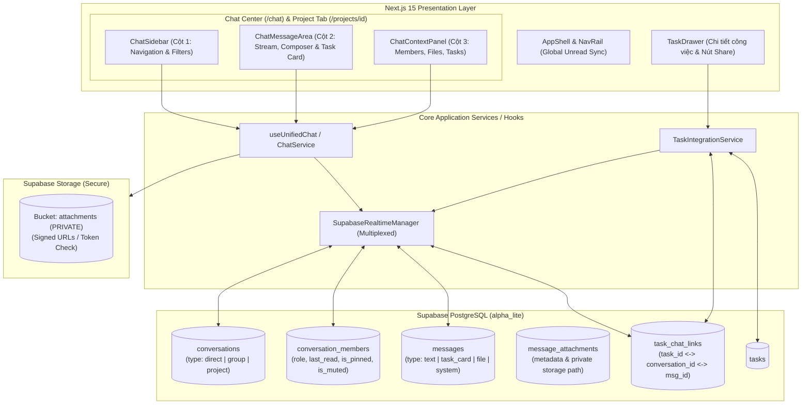
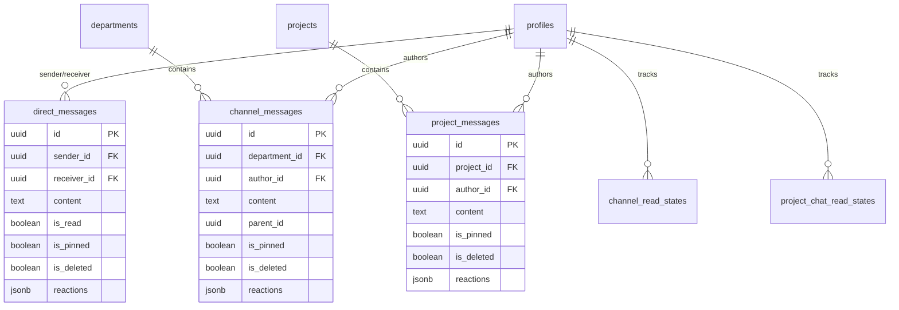
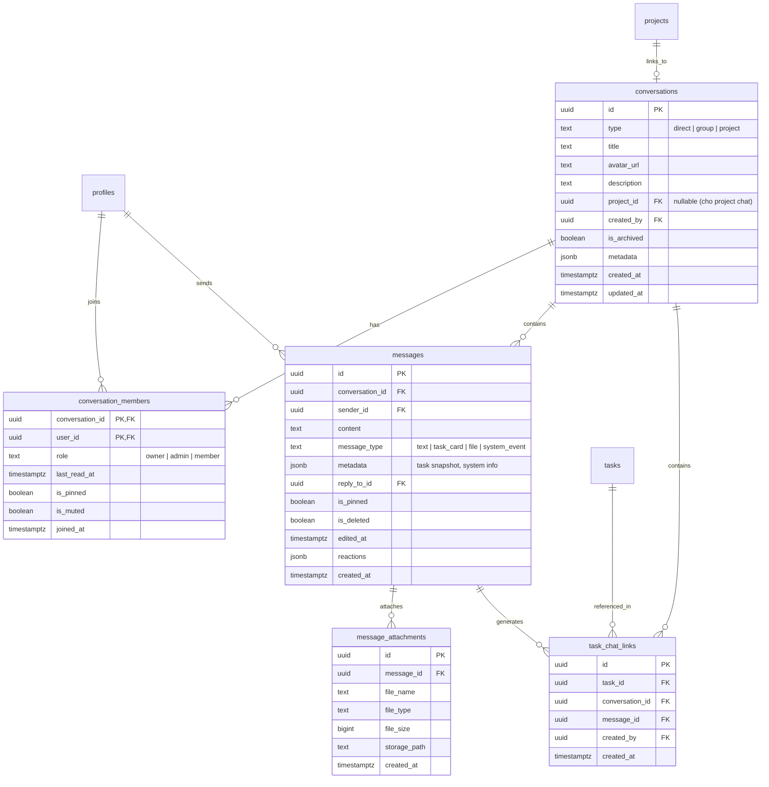
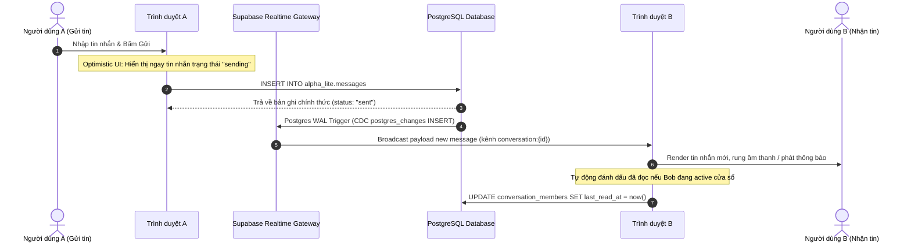

# THIẾT KẾ KIẾN TRÚC MỤC TIÊU (TARGET ARCHITECTURE)
**Tài liệu:** `docs/features/chat/05-TARGET-ARCHITECTURE.md`  
**Dự án:** Alpha Task Manager — Phân hệ Unified Chat & Collaboration  
**Mô hình:** Unified Polymorphic Collaboration Architecture

---

## I. KIẾN TRÚC HIỆN TẠI VS KIẾN TRÚC ĐỀ XUẤT

### 1. Kiến trúc phân mảnh hiện tại (Current Fragmented Architecture)

Hiện tại, hệ thống tách rời thành 3 bảng dữ liệu vật lý riêng biệt không có thực thể cuộc trò chuyện chung:



**Nhược điểm kiến trúc hiện tại:**
- **Code Bloat & Trùng lặp:** Logic load tin, subscribe realtime, upload file, reactions, pins bị duplicate giữa `ChatContainer.tsx` và `ProjectChatTab.tsx`.
- **Không có thực thể Conversation:** Không thể quản lý Group Chat tự do, không lưu được metadata nhóm, không thể ghim hoặc tắt chuông hội thoại.
- **Rò rỉ bảo mật RLS:** `project_messages` mở cho toàn công ty đọc (`alpha_lite.is_active_staff()`), bucket file là public.
- **Không có liên kết cấu trúc với Task:** Chỉ dùng markdown text link.

---

### 2. Kiến trúc hợp nhất đề xuất (Proposed Unified Architecture)

Chuyển đổi sang mô hình **Unified Polymorphic Conversations**, chuẩn hóa toàn bộ giao tiếp vào một luồng dữ liệu duy nhất:



---

## II. SO SÁNH ERD HIỆN TẠI VÀ ERD MỤC TIÊU

### 1. ERD Hiện tại (Phân mảnh)


### 2. ERD Mục tiêu (Unified Collaboration Model)


---

## III. ĐÁNH GIÁ ĐÁNH ĐỔI KỸ THUẬT (TECHNICAL TRADE-OFFS)

### Phương án 1: Hợp nhất đa hình (Unified Polymorphic Model) — **[KHUYẾN NGHỊ]**
- **Cơ chế:** Gộp toàn bộ Direct, Group, Project, Department thành 1 bảng `conversations` và 1 bảng `messages`. Phân loại qua cột `type`.
- **Ưu điểm:**
  - Code frontend tái sử dụng 100%: 1 component `ChatMessageArea` duy nhất render cho mọi loại chat.
  - Hỗ trợ tức thì tính năng Group Chat tự do mà không cần tạo thêm bảng.
  - Dễ dàng mở rộng tính năng: Ghim hội thoại, tắt chuông, tìm kiếm toàn văn, thread đều dùng chung 1 API.
  - Dễ quản lý Realtime: Chỉ subscribe 1 bảng `messages` với filter `conversation_id`.
- **Nhược điểm:**
  - Cần viết migration chuyển dữ liệu cũ (backfill data) và đảm bảo tính liên tục của dữ liệu.
- **Lý do chọn:** Đây là chuẩn kiến trúc của mọi nền tảng chat hiện đại (Slack, Lark, Discord, Telegram). Tiết kiệm chi phí bảo trì lâu dài.

### Phương án 2: Giữ 3 bảng cũ và dựng cầu nối trung gian (Linking Bridge)
- **Cơ chế:** Giữ nguyên `direct_messages`, `channel_messages`, `project_messages`. Tạo thêm bảng `group_messages` riêng và dùng `UNION ALL` ở frontend hoặc database view.
- **Ưu điểm:** Không cần migration dữ liệu cũ.
- **Nhược điểm:**
  - Technical debt ngày càng phình to (4 bảng tin nhắn riêng biệt).
  - Code frontend phải xử lý 4 state mảng khác nhau, logic realtime phân mảnh.
  - Truy vấn tìm kiếm toàn cục cực kỳ chậm vì phải UNION nhiều bảng lớn.
  - Nguy cơ bug không đồng bộ rất cao.
- **Kết luận:** **Bác bỏ Phương án 2.**

---

## IV. ĐẶC TẢ API VÀ HỢP ĐỒNG DỮ LIỆU (SERVICE CONTRACTS)

### 1. Typescript Interfaces
```typescript
export type ConversationType = "direct" | "group" | "project";
export type ConversationMemberRole = "owner" | "admin" | "member";
export type MessageType = "text" | "task_card" | "file" | "system_event";

export interface UnifiedConversation {
  id: string;
  type: ConversationType;
  title: string | null;
  avatar_url: string | null;
  description: string | null;
  project_id: string | null;
  created_by: string | null;
  is_archived: boolean;
  metadata?: Record<string, any>;
  created_at: string;
  updated_at: string;
  // Computed client-side fields:
  members?: ConversationMember[];
  lastMessage?: MessagePreview;
  unreadCount: number;
  isPinned: boolean;
  isMuted: boolean;
}

export interface ConversationMember {
  conversation_id: string;
  user_id: string;
  role: ConversationMemberRole;
  last_read_at: string;
  is_pinned: boolean;
  is_muted: boolean;
  joined_at: string;
  profile?: Profile;
}

export interface UnifiedMessage {
  id: string;
  conversation_id: string;
  sender_id: string;
  content: string;
  message_type: MessageType;
  metadata?: {
    task?: {
      id: string;
      title: string;
      status: string;
      priority: string;
      due_date: string | null;
      assignee_name?: string;
      project_name?: string;
    };
    system_event?: string;
  };
  reply_to_id: string | null;
  is_pinned: boolean;
  is_deleted: boolean;
  edited_at: string | null;
  reactions: Record<string, string[]>;
  created_at: string;
  sender?: Profile;
  attachments?: MessageAttachment[];
}
```

---

## V. LUỒNG TRUYỀN PHÁT THỜI GIAN THỰC (REALTIME SEQUENCE FLOW)



---

## VI. MA TRẬN PHÂN QUYỀN TRUY CẬP (PERMISSION MATRIX)

| Hành động | Direct Chat (1-1) | Group Chat Tự Do | Project Chat |
|---|---|---|---|
| **Xem tin nhắn (Read)** | Chỉ 2 thành viên trong cuộc trò chuyện | Chỉ thành viên có trong `conversation_members` | **Chỉ thành viên thuộc `project_members`** |
| **Gửi tin nhắn (Send)** | 2 thành viên | Thành viên trong nhóm | Thành viên dự án |
| **Chỉnh sửa / Thu hồi tin** | Chỉ tác giả (`auth.uid() = sender_id`) | Chỉ tác giả | Chỉ tác giả |
| **Ghim tin nhắn (Pin)** | Cả 2 thành viên | Owner & Admin nhóm | Trưởng dự án (PM) & Admin |
| **Thêm / Xóa thành viên** | Không áp dụng (luôn là 2 người) | Owner & Admin nhóm | Đồng bộ tự động theo `project_members` |
| **Đổi tên / Ảnh nhóm** | Không áp dụng | Owner & Admin nhóm | Đồng bộ từ thông tin Dự án |
| **Giải tán / Xóa nhóm** | Không áp dụng | Chỉ Owner nhóm | Đi kèm xóa Dự án |

---

## VII. CHIẾN LƯỢC DI TRÚ VÀ TƯƠNG THÍCH NGƯỢC (MIGRATION STRATEGY)

Nhằm đảm bảo an toàn tuyệt đối cho dữ liệu hiện có:
1. **Giai đoạn 1 (Non-destructive Schema Creation):**
   - Chạy migration tạo các bảng mới: `conversations`, `conversation_members`, `messages`, `task_chat_links`.
   - Các bảng cũ (`direct_messages`, `channel_messages`, `project_messages`) vẫn giữ nguyên 100%, không bị sửa đổi cấu trúc.
2. **Giai đoạn 2 (Data Backfill Script):**
   - Chạy script SQL idempotent để chuyển toàn bộ dữ liệu lịch sử cũ sang bảng mới:
     - Tạo cuộc hội thoại cho từng cặp Direct Message có trong `direct_messages`.
     - Tạo cuộc hội thoại cho từng phòng ban trong `departments`.
     - Tạo cuộc hội thoại cho từng dự án trong `projects`.
     - Chuyển toàn bộ các dòng tin nhắn cũ vào bảng `messages` mới.
3. **Giai đoạn 3 (Feature Verification & Switchover):**
   - Triển khai code frontend mới trỏ vào bảng hợp nhất.
   - Kiểm tra đối soát số lượng tin nhắn giữa bảng cũ và bảng mới đạt tỷ lệ khớp 100%.
4. **Chiến lược Rollback khẩn cấp:**
   - Trong trường hợp phát sinh sự cố không mong muốn, hệ thống chỉ cần switch phiên bản frontend cũ trở lại, vì các bảng dữ liệu cũ vẫn nguyên vẹn 100%.
